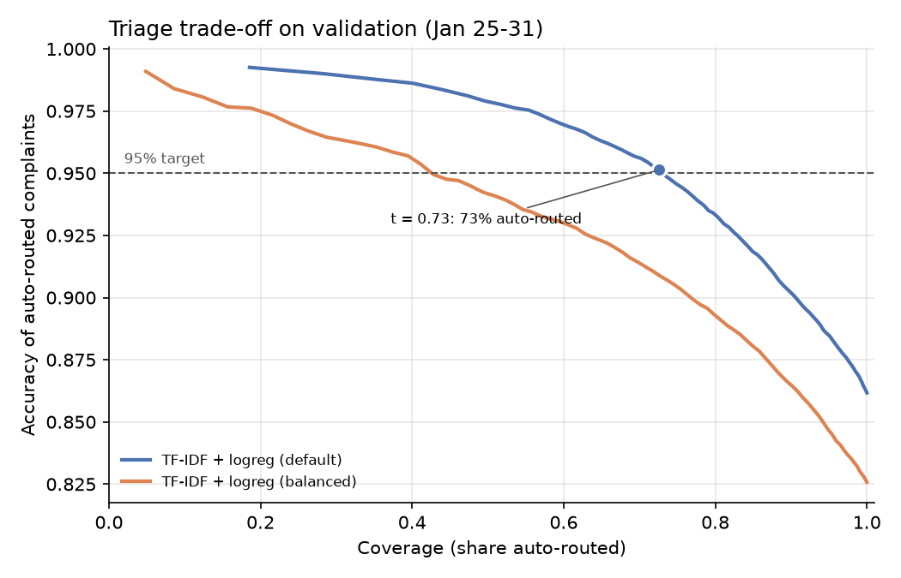

# Complaint Triage with NLP

Route consumer complaints to the right product team automatically, using only the text the customer wrote. Complaints the model isn't confident about, go to a person.


## Result in one line

On February 2025 complaints (never seen during training), a TF-IDF + logistic regression model **auto-routes 65.5% of complaints at 93.4% accuracy** and sends the rest (34.5%) to people. Macro-F1 across 10 products is 0.649.

## The problem

Financial companies and regulators receive thousands of complaints a day. Each one has to reach the right team (credit cards, mortgages, debt collection, and so on) before anyone can fix it. Sorting by hand is slow and inconsistent.

**Question:** given only the complaint text, can a model predict which product team should handle it, and say when it isn't sure?

## Data

- **Source:** US Consumer Financial Protection Bureau (CFPB) Consumer Complaint Database. In September 2026 the CFPB removed narratives from the live database, so the data comes from the [Narratives Archive](https://www.consumerfinance.gov/foia-requests/foia-electronic-reading-room/cfpb-consumer-complaint-database-narratives-archive/) (FOIA reading room).
- **Batch used:** `CCDB_Export_9_January_2025_through_February_2025.zip` (75.5 MB): 811,019 complaints, of which 265,405 (32.7%) have a narrative.
- **Input:** `Consumer complaint narrative`. **Label:** `Product` (10 classes after folding two small products into "Other").
- After cleaning and deduplication: **138,042 distinct narratives**.

## Approach

| Notebook | What it does |
|---|---|
| `01_explore` | Columns, missing values, narrative share, duplicates, product balance, length, redaction (`XXXX`) |
| `02_clean` | Remove redaction, drop texts filed under different products, exact dedupe (keep earliest), time split, leakage check |
| `03_baseline` | Majority class vs TF-IDF (1-2 grams) + logistic regression (default and balanced weights) |
| `04_embeddings` | Sentence embeddings (`all-MiniLM-L6-v2`) + logistic regression |
| `05_triage_threshold` | Confidence threshold chosen on validation for 95% auto-routed accuracy; one final evaluation on test |
| `06_explain_errors` | Top terms per product, one explained prediction, confident mistakes, 30 errors read by hand |

**Split by time, not at random:** train on Jan 1-24, choose the threshold on Jan 25-31, test once on February. This matches real use (the model only sees the past) and exposes drift. No identical text appears in two splits.

## Results

Validation (Jan 25-31, 18,093 complaints):

| Model | Macro-F1 | Weighted F1 | Accuracy |
|---|---|---|---|
| Majority class | 0.078 | 0.499 | 0.639 |
| TF-IDF + logistic regression | 0.653 | 0.853 | 0.862 |
| TF-IDF + logistic regression (balanced) | 0.673 | 0.836 | 0.826 |
| MiniLM embeddings + logistic regression (balanced) | 0.598 | 0.798 | 0.771 |

Triage (TF-IDF + logistic regression, threshold 0.73 chosen on validation):

| | Validation | Test (February) |
|---|---|---|
| Auto-routed | 72.6% | 65.5% |
| Accuracy of auto-routed | 95.1% | 93.4% |
| Macro-F1 (all complaints) | 0.653 | 0.649 |



Key findings ([full one-page findings](reports/findings.md)):
- A simple, explainable model beat pretrained sentence embeddings on every product.
- The balanced model had the best macro-F1 but was less confident, so it could auto-route only 41.2% at 95% accuracy (default model: 72.6%).
- The 95% target set on validation fell to 93.4% on test because February's product mix differed from January's.
- Most confident errors are complaints about two products at once (for example a loan disputed on a credit report), not clear model failures.

Every number: [`reports/results_summary.md`](reports/results_summary.md).

## Limitations

- Narratives are published only with consumer consent (32.7% here), so the text may not represent every complaint.
- Labels are chosen by consumers and are noisy.
- Near-duplicate template complaints survive exact deduplication and may inflate scores.
- One two-month batch, US only; the CFPB renamed its products in 2026.
- "Other" mixes two unrelated small products.

## Project structure

```
complaint-triage/
  README.md
  data/raw/          original download, never edited (not committed)
  data/processed/    cleaned data and embeddings (not committed)
  models/            fitted pipelines (not committed)
  notebooks/         01_explore ... 06_explain_errors
  reports/           figures/, findings.md, results_summary.md, score files
```

## How to run

1. Download `CCDB_Export_9_January_2025_through_February_2025.zip` from the narratives archive into `data/raw/`.
2. Create the environment:

```
conda create -n triage python=3.12 -y
conda activate triage
conda install pandas scikit-learn matplotlib seaborn jupyter ipykernel -y
pip install sentence-transformers   # only for notebook 04 (pulls in PyTorch)
```

3. Run the notebooks in order. Notebook 04 encodes all complaints once (about 50 minutes on a laptop CPU) and caches the result.

Versions used: Python 3.12.16, pandas 3.1.0, scikit-learn 1.9.1, sentence-transformers 6.3.0, torch 2.15.0 (CPU).

## Author

Salman Khursheed
